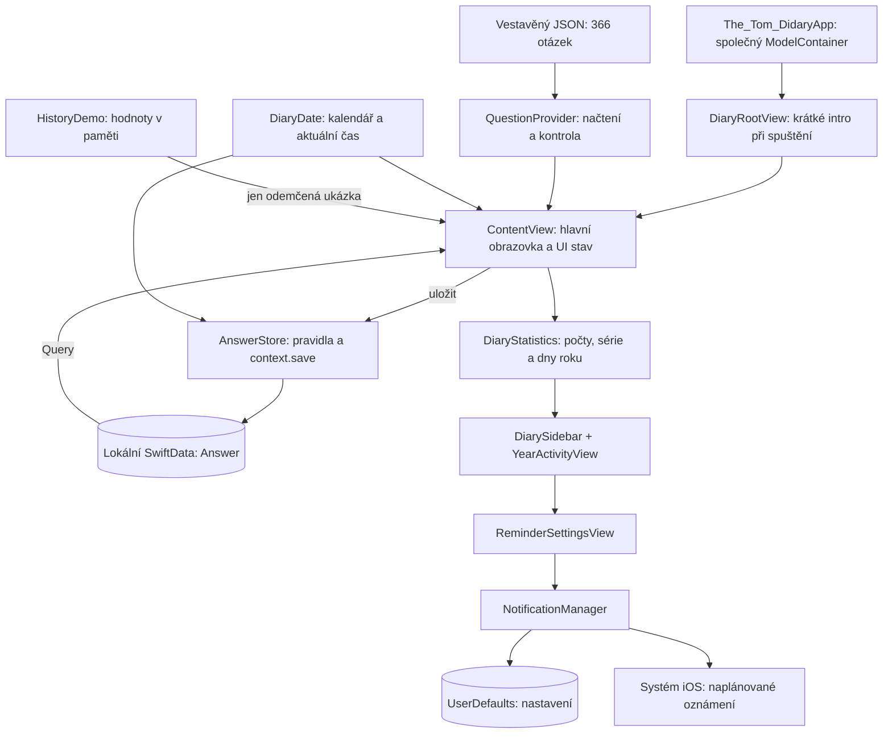

# Architektura a mapa souborů

## Základní uspořádání

Aplikace používá **SwiftUI** pro obrazovky, **SwiftData** pro odpovědi a **UserNotifications** pro místní připomínky. Nemá vlastní server, přihlášení ani externí knihovny. Otázky jsou součástí balíčku aplikace a nepotřebují internet.

Když něco upravuješ, hledej nejprve vrstvu odpovědnou za dané chování. Barva kalendáře patří do `YearActivityView`, pravidlo série do `DiaryStatistics`, zákaz úpravy včerejší odpovědi do `AnswerStore` a nabídka editoru do `ContentView`. Tím zůstávají pravidla nezávislá na vzhledu.

## Soubory aplikace

Všechny cesty v této kapitole jsou relativní ke kořeni repozitáře.

| Soubor | Odpovědnost a důležité části |
| --- | --- |
| `The Tom Didary/The_Tom_DidaryApp.swift` | Vstupní bod `@main`. Sestaví schéma s modelem `Answer`, vytvoří jediný trvalý `ModelContainer` a vloží ho do SwiftUI prostředí. Debug UI test může místo běžné databáze použít vlastní soubor podle UUID. |
| `The Tom Didary/Models/Answers.swift` | Model `Answer`: `day`, `month`, `year`, `date`, `text`. Jeho kalendářní pole jsou klíčem denního záznamu. Soubor má historicky množné jméno, třída je jednotné číslo. |
| `The Tom Didary/AnswerStore.swift` | Vyhledání jednoho dne, historie stejných dnů starších let a ukládání. Kontroluje právo zápisu, odstraňuje krajní mezery a aktualizuje existující den. Při chybě obnoví stav modelu v kontextu. |
| `The Tom Didary/QuestionProvider.swift` | Hodnota `Question`, načtení JSONu, převod českých dat a kontrola úplnosti, platnosti, duplicity a délky emoji. `loadError` dovolí zobrazit chybu na stránce. |
| `The Tom Didary/Resources/denik_otazky_kompletni_final_v2.json` | 366 záznamů s klíči `datum`, `otazka`, `emoji`. Toto je katalog otázek, nikoli databáze odpovědí. |
| `The Tom Didary/DiaryDate.swift` | Gregoriánský kalendář v aktuálním pásmu, přísné zpracování RRRR-MM-DD, formátování technického data a porovnání kalendářních dnů. Odděluje den prohlížení a skutečný čas; izolovaný Debug UI test může čas simulovat. |
| `The Tom Didary/DiaryRootView.swift` | Kořen aplikace a `LaunchIntroductionView`: logo na celé obrazovce po 2,5 sekundy, poté krátké prolnutí. Stav je jen v paměti; návrat z pozadí intro neopakuje. Zápisník je připojený pod intrem a připravuje se souběžně. |
| `The Tom Didary/ContentView.swift` | Hlavní stránka s nadpisem „Roční zápisník otázek“, editor/čtecí karta, minulé roky, skrytý výběr data a celostránkové menu. Obsahuje `HistoryEntry` a dočasný `ClosedDraft`, zpracovává přechod na pozadí a změnu dne. |
| `The Tom Didary/DiarySidebar.swift` | Obsah menu: název, zavření, počty, rok, série, nastavení a patička. Dostává hodnoty a akce od rodiče. Pět klepnutí na verzi odemkne testovací položku. |
| `The Tom Didary/DiaryStatistics.swift` | Čisté výpočty z dat odpovědí: deduplikace dnů, ignorování budoucnosti, letošní/celkový součet, odložení celkového součtu, aktuální série a týdny pro přehled roku. |
| `The Tom Didary/YearActivityView.swift` | Vykreslení přehledu roku ve dvou pruzích týdnů. Barvy, obrys dneška, legenda a hlasové popisky jednotlivých dnů. |
| `The Tom Didary/NotificationManager.swift` | `ReminderPreferences`, validace, tvorba opakovaného požadavku, `ReminderPreferencesStore` a správce oprávnění/plánování. Ukládá nastavení do UserDefaults a komunikuje se systémem. |
| `The Tom Didary/ReminderSettingsView.swift` | Formulář zapnutí, času, nadpisu a obsahu s náhledem. Pracovní kopie se uloží až tlačítkem Uložit; při chybě se formulář nezavře. |
| `The Tom Didary/HistoryDemo.swift` | Čtyři dlouhé ukázkové texty pro předchozí roky. Vytváří pouze `HistoryEntry`, nikoli SwiftData objekty. Ukázky se nikdy nezapočítají ani nezapisují. |
| `The Tom Didary/Item.swift` | Nepoužitý model původní šablony Xcode. Není v aktivním schématu a není úložištěm deníku. |
| `The Tom Didary/Assets.xcassets/DiaryLaunchArtwork.imageset/` | Kopie stejného 1024px obrázku jako u ikonky, dostupná běžnému SwiftUI `Image`. AppIcon sám není obrázkový asset pro obsah obrazovky. |
| `The Tom Didary/Assets.xcassets/Contents.json` | Metadata katalogu obrázků. |
| `The Tom Didary/Assets.xcassets/AccentColor.colorset/Contents.json` | Výchozí položka barvy akcentu. Současná tlačítka používají systémový vzhled. |
| `The Tom Didary/Assets.xcassets/AppIcon.appiconset/Contents.json` | Přiřazení konkrétních velikostí ikonky pro iPhone/iPad a App Store. Zahrnuje malé ikony oznámení; prázdné varianty dark/tinted odstraněné. |
| `The Tom Didary/Assets.xcassets/AppIcon.appiconset/AppIcon-1024.png` | Neprůhledný čtvercový podklad 1024 × 1024 a 14 odvozených PNG ve stejném katalogu, včetně `AppIcon-20x20@2x.png` a `AppIcon-20x20@3x.png` pro oznámení. |

## Testy a konfigurace

| Soubor | Co obsahuje |
| --- | --- |
| `The Tom DidaryTests/DiaryTests.swift` | 9 jednotkových testů katalogu, dat, ukládání, historie a hranice uzavřeného dne. |
| `The Tom DidaryTests/DiaryStatisticsTests.swift` | 7 jednotkových testů počtů, série, výročí a přehledu roku. |
| `The Tom DidaryTests/ReminderTests.swift` | 3 jednotkové testy požadavku, validace a trvalého nastavení. |
| `The Tom DidaryTests/The_Tom_DidaryTests.swift` | 1 původní prázdný test šablony; neposkytuje funkční kontrolu. |
| `The Tom DidaryUITests/DiaryFlowTests.swift` | 7 scénářů ovládajících skutečnou aplikaci. Pomocné metody pro spuštění, psaní, uložení, menu, testovací datum a posun hodin. |
| `The Tom DidaryUITests/The_Tom_DidaryUITests.swift` | Základní spuštění a měření rychlosti startu z původní šablony. |
| `The Tom DidaryUITests/The_Tom_DidaryUITestsLaunchTests.swift` | Scénář zámku orientace na výšku při otáčení telefonu. |
| `The Tom Didary.xcodeproj/project.pbxproj` | Targety, konfigurace Debug/Release, minimální systémy, podepisování, verze, zobrazovaný název a orientace. Synchronizované skupiny přebírají soubory ze zdrojových složek. |
| `The Tom Didary.xcodeproj/project.xcworkspace/contents.xcworkspacedata` | Interní workspace projektu pro Xcode. |
| `The Tom Didary.xcodeproj/xcuserdata/…` | Osobní nastavení konkrétního uživatele Xcode. Není nutné pro sestavení a nemá se nově verzovat. |
| `.gitignore` | Vylučuje build produkty, lokální nastavení, osobní databáze a podpisové soubory. Již verzovaný soubor samotné přidání pravidla neodstraní z indexu. |
| `README.md`, `Documentation/` | Tento návod, historie, matice testů, podklady ikonky a malé přehledy výsledků. |

## Co znamenají anotace ve Swiftu

| Zápis | Význam v této aplikaci |
| --- | --- |
| `struct …: View` | Popis obrazovky. SwiftUI znovu vyhodnotí `body`, když se změní použitý stav. |
| `@State` | Paměť obrazovky: rozepsaný text, otevřené menu nebo skryté nastavení. Sama se po ukončení aplikace neobnoví. |
| `$text` | Binding, tedy obousměrné propojení editoru s proměnnou `text`. |
| `@Environment` | Hodnota předaná rodičem nebo systémem: kontext databáze, fáze aplikace, zavření obrazovky či omezení animací. |
| `@Query` | Pozorovaný seznam modelů ze SwiftData. Změna databáze se propíše do UI bez ručního obnovování celého seznamu. |
| `@Model` | Datový objekt spravovaný SwiftData, zde `Answer`. |
| `@FocusState` | Ovládání zaměření editoru a zobrazení klávesnice. |
| `@MainActor` | Kód běží na hlavním aktoru vhodném pro UI a příslušný ModelContext. Není to nová databáze ani background proces. |
| `async` / `await` | Čekání na systémové operace bez blokování obrazovky, například zjištění oprávnění oznámení. |
| `throws` / `do` / `catch` | Chyba se předá volajícímu, který ji zachytí a může nechat rozepsaný text na obrazovce. |
| `#if DEBUG` | Část kódu existuje pouze ve vývojové konfiguraci. Skryté ruční prohlížení data do této části nepatří; simulované hodiny ano. |
| `accessibilityIdentifier` | Stabilní technické označení prvku pro UI testy. Viditelný text nebo popisek pro VoiceOver se nastavuje zvlášť. |

Příklady `#Preview` používají databázi pouze v paměti. Náhled Xcode není důkaz, že odpověď přežije ukončení aplikace; to ověřují samostatné testy trvalého úložiště.

## Rozšíření ve verzi 1.1.0

Zálohování nemění model `Answer` ani identitu databáze. Nové soubory a jejich odpovědnosti popisuje [Zálohování a podpis](backup-and-signing.md#soubory). `ContentView` po úspěšném místním save předává snapshot správci zálohy; menu zobrazuje správce jako pozorované objekty. Souborové operace provádí samostatný aktor. `SigningReminder` používá skutečný profil podepsané aplikace a vlastní ID oznámení.
