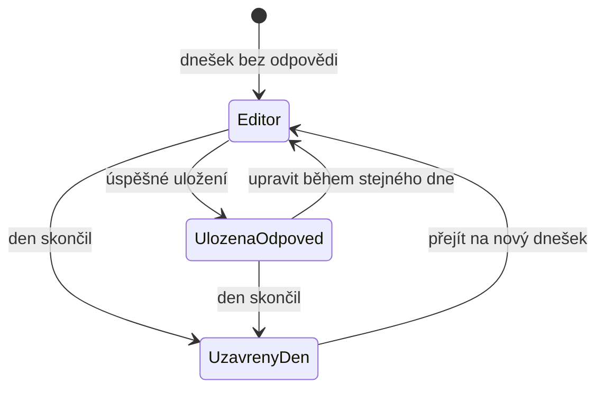

# Data a pravidla deníku

## Katalog otázek

JSON uvnitř aplikace obsahuje jednu otázku pro každý den a měsíc v přestupném roce. Rok součástí katalogu není; otázky se opakují, aby bylo možné porovnávat odpovědi v dalších letech.

```json
{
  "datum": "13. září",
  "otazka": "Co by ti nyní zlepšilo náladu?",
  "emoji": "🌤️"
}
```

`QuestionProvider` po načtení odmítne neplatné datum, duplicitní den, prázdnou otázku, emoji mimo délku 1–2 znaků a neúplný katalog. Názvy měsíců porovnává bez ohledu na diakritiku a velikost písmen. Nejde o úplnou kontrolu, zda je každý znak skutečně emoji; současná validace kontroluje délku. Dnešní otázka se vybírá podle dne a měsíce, nikoli podle pořadí dne v roce. Přestupný den tak neposune otázky v březnu.

Všech 365 původních textů bylo při doplňování zachováno. Přibyla otázka pro 29. února a samostatné emoji. Texty lze upravovat v JSONu, ale změna otázky změní také otázku zobrazovanou vedle starších odpovědí: odpověď v1 nemá uloženou vlastní historickou kopii zadání.

## Odpovědi a ukládání

Model `Answer` obsahuje:

| Pole | Význam |
| --- | --- |
| `day`, `month`, `year` | Logický kalendářní klíč odpovědi. Uložené číslo dne se při cestování samo nepřepočítává. |
| `date` | Datum, ke kterému odpověď patří. Není to datum poslední úpravy. |
| `text` | Odpověď po odstranění krajních mezer a prázdných řádků. |

SwiftData uchovává odpovědi v datovém prostoru konkrétní instalace. Běžné úložiště vybírá systém; do zdrojového repozitáře se tento soubor nekopíruje. Data přežijí zavření a nové spuštění. Úspěšné `context.save()` je výslovný zápis, nikoli pouze změna proměnné na obrazovce.

`AnswerStore.save` nejprve ověří neprázdný text a aktuální den, poté vyhledá existující odpověď. Pro stejný den změní její text, jinak vloží nový objekt. Prázdný vstup nic nemaže. Při chybě zápisu obnoví starý text nebo odstraní právě vložený objekt z kontextu; obrazovka zachová rozepsaný text a zobrazí chybu.

Jedinečnost dne nyní zajišťuje tato ukládací cesta, **nikoli databázový unique constraint**. Před budoucím importem a synchronizací bude třeba navrhnout slučování duplicit, stabilní identitu a konflikty. V1 nemá mazání odpovědí ani import/export.

**Cloud není zapnutý.** Aplikace nemá nakonfigurovaný CloudKit kontejner ani vlastní přenos na nové zařízení. Běžná systémová záloha telefonu je samostatná funkce iOS; v tomto projektu jsme neověřili obnovu databáze ze zálohy. Git zálohuje vývojové soubory, ne osobní deník. Aktualizace existující instalace se stejnou identitou zachovává její datový prostor; odinstalování jej odstraní.

## Dnešek, editor a půlnoc

Obrazovka rozlišuje `today` (prohlížený den), `currentDate` (aktuální čas pro UI), `text` (rozepsaná hodnota) a `savedText` (poslední úspěšně uložená hodnota).



Po uložení editor i hlavní tlačítko zmizí, klávesnice se zavře a dnešek nabídne odkaz na úpravu. Odkaz otevře předvyplněný text. Minulé ani budoucí dny nemají editor, a to ani přes testovací nastavení. Prázdná úprava již uložené odpovědi se nepovažuje za smazání.

Aktuální kalendář je gregoriánský v pásmu telefonu. Právo zápisu znamená stejný kalendářní den, ne posledních 24 hodin. Při každém uložení se znovu čte aktuální čas v UI a také v `AnswerStore`: nestačí, že editor byl před půlnocí otevřený. Verze funguje offline a neověřuje čas proti serveru; ruční změna systémových hodin není ochranou proti obcházení pravidla.

Obnovení dne probíhá při návratu do aktivního stavu, přes oznámení `NSCalendarDayChanged`, ruční obnovení a doplňkový timer po 30 sekundách. Timer nezajišťuje běh aplikace na pozadí. Při přechodu do neaktivního stavu se neprázdné změny zkusí uložit ještě k jejich dni.

Pokud skončí den s neuloženou úpravou, uložená odpověď se nepřepíše. `ClosedDraft` dočasně nabídne rozepsaný text ke zkopírování. Je pouze v paměti, po úplném ukončení zmizí a neobnoví se. Nejde o druhý trvalý záznam nebo zálohu.

## Minulé roky a ukázky

Historie vybírá odpovědi se stejným dnem a měsícem a menším rokem než prohlížený den. Řadí se sestupně. 29. únor zobrazí jen jiné skutečné 29. únory. Text není zkrácený na pevný počet řádků; karta roste a celá stránka se svisle posouvá.

Ukázky jsou čtyři dlouhé odstavce pro minulé roky. Zapnou se pouze po odemčení vývojových možností, aktivaci přepínače a tehdy, když den nemá vlastní starší odpovědi. Vznikají jako obyčejné hodnoty `HistoryEntry` v paměti. Nevstupují do SwiftData, součtů ani série. Neexistující data se vynechají.

## Statistiky

Počítají se neprázdné skutečné odpovědi podle uložených kalendářních polí. Každý den se počítá jednou a budoucí dny se ignorují. Menu používá skutečný aktuální rok i při prohlížení jiného data.

- **Letos zapsáno:** vždy viditelný součet letošních dnů.
- **Za celou dobu:** viditelný až jeden kalendářní rok a jeden den po nejstarším zaznamenaném dni. První odpověď 11. 10. 2025 znamená odkrytí 12. 10. 2026. První odpověď 29. 2. 2024 znamená odkrytí 1. 3. 2025.
- **Aktuální streak:** souvislá řada končící dnes, pokud je dnešek vyplněný; jinak řada končící včera. Celý vynechaný včerejšek ji přeruší. Není to nejdelší historická série.
- **Roční přehled:** pondělí nahoře, neděle dole, jeden sloupec na týden. Celý rok je rozdělen do dvou pruhů. Zelená = zapsáno, žlutá = minulý nevyplněný den, světlejší žlutá s obrysem = dnešek čeká na zápis, šedá = budoucnost. Prázdná krajní místa nepatří do roku.

Dny se přičítají kalendářně, ne jako 86 400 sekund, aby série fungovala i přes změnu letního času.

## Oznámení

Výchozí nastavení je vypnutá denní připomínka ve 20:00. Uživatel si volí hodinu/minutu, nadpis a text. Tyto malé hodnoty se ukládají jako JSON v UserDefaults pod klíčem `diary.reminder.preferences.v1`.

Naplánované lokální oznámení má stálé ID `daily-diary-reminder`, kalendářní trigger s opakováním a standardní zvuk. Stejné ID nahradí předchozí nastavení; vypnutí zruší tento požadavek. Starší existující připomínka se při prvním načtení nového formuláře může převzít.

Systémové oprávnění se žádá až při zapnutí. Zamítnuté oprávnění vyžaduje změnu v nastavení iOS, aplikace je nemůže sama obejít. Nové nastavení se zapíše až po úspěšném naplánování. Notifikace je nezávislá na dnešní odpovědi a může přijít i po jejím uložení. V1 nemá vlastní foreground banner, vzdálené push notifikace ani automatické potlačení po zápisu.
